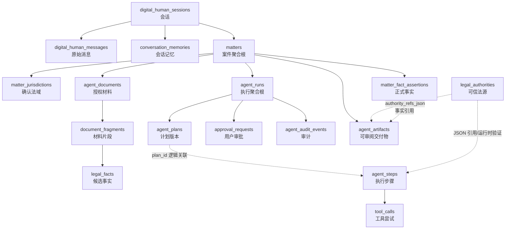

# Database Map

> 基于 2026-07-27 的源码、Alembic、`sql/public.sql` 与本地 PostgreSQL `public` schema 交叉核对。本文描述整个 `law` 项目，不以单一开发阶段为边界。

## 1. 数据库总体结构

### 1.1 事实口径

| 项目 | 数量 | 说明 |
| --- | ---: | --- |
| PostgreSQL 实际表 | 80 | `public` schema 当前表 |
| SQLAlchemy ORM 表 | 72 | 主要定义在 `db_models.py`、`knowledge_graph.py`、`legal_agent_system/models.py` |
| 仅初始化 SQL / 实库存在的历史表 | 7 | 3 张文书消息表、4 张旧知识图谱表 |
| Alembic 管理表 | 1 | `alembic_version` |
| 数据库外键 | 47 | 分布在 40 张表；其余关系依靠 JSON、ID 字段或代码查询维护 |
| SQLAlchemy `relationship()` | 4 | 仅用于 `knowledge_nodes ↔ knowledge_relationships` 的双向导航 |
| 业务域 | 14 | 按真实业务职责划分 |

数据库由两类系统叠加而成：

1. **平台原有功能库**：合同审查、普法问答、模拟庭审、纠纷管理、文书起草、案例检索、知识图谱和法律工具。
2. **案件 Agent 库**：数字人会话、Matter、材料与事实、Agent Runtime、劳动纠纷、法域与可信法源。

第二类以 `matters` 为案件聚合根，以 `agent_runs` 为执行聚合根。聊天记忆不是正式案件事实；正式事实进入 `matter_fact_assertions`、`labor_case_triages`、`labor_dispute_profiles`，材料候选事实进入 `legal_facts`。

### 1.2 数据真相层级

| 层级 | 代表表 | 含义 |
| --- | --- | --- |
| 原始输入 | `digital_human_messages`、`agent_documents` | 用户原话和用户授权材料 |
| 会话记忆 | `conversation_memories` | 帮助对话续接，不等于案件正式事实 |
| 材料候选事实 | `legal_facts` | 带材料位置的候选事实，仍需确认 |
| 正式业务事实 | `matter_fact_assertions`、`labor_case_triages`、`labor_dispute_profiles` | 由用户确认或受控业务服务写入 |
| 执行过程 | `agent_runs`、`agent_plans`、`agent_steps`、`tool_calls` | Agent 如何完成任务，不是案件事实 |
| 法律依据 | `legal_authorities` | 经同步、版本和新鲜度校验的法源 |
| 可审阅结果 | `agent_artifacts` | 草稿等交付物，引用事实与法源 ID |

## 2. 业务域划分

### 2.1 业务域职责

| 业务域 | 表数 | 职责 |
| --- | ---: | --- |
| Conversation | 6 | 保存数字人和旧普法问答的会话、消息、记忆与请求恢复状态 |
| Matter | 5 | 保存案件工作区、正式事实、法域和劳动案件业务状态 |
| Materials & Evidence | 4 | 保存授权材料、材料分片、候选事实和最终交付物 |
| Agent Runtime | 8 | 保存 Run、Plan、Step、工具调用、审批、幂等、审计和事件 |
| Legal Source | 4 | 保存法源正文、同步批次、原始快照和人工复核 |
| Contract Review | 2 | 保存合同正文及逐条风险分析 |
| Document Drafting | 7 | 保存文书起草任务、类型详情及历史消息表 |
| Dispute Management | 7 | 保存传统纠纷整理及其证据、路径、文书、预测、提醒和风险 |
| Mock Court | 5 | 保存模拟案件、庭审会话、证据、争议焦点和辩论回合 |
| Case & Analysis | 4 | 保存案例库、案例解释检索、案情分析和相似文书检索历史 |
| Knowledge Graph | 7 | 保存现行知识图谱，以及一套不再被当前路由使用的旧图谱表 |
| Legal Tools | 16 | 保存各类计算器、日历和 UML 工具的历史记录 |
| Personalization | 4 | 保存用户、智能体配置、智能体用量和收藏 |
| System | 1 | 保存 Alembic 迁移版本 |

### 2.2 业务域树

```text
Conversation
├── digital_human_sessions
├── digital_human_messages
├── conversation_memories
├── digital_human_requests
├── legal_chat_sessions
└── legal_chat_messages

Matter
├── matters
├── matter_jurisdictions
├── matter_fact_assertions
├── labor_case_triages
└── labor_dispute_profiles

Materials & Evidence
├── agent_documents
├── document_fragments
├── legal_facts
└── agent_artifacts

Agent Runtime
├── agent_runs
├── agent_plans
├── agent_steps
├── tool_calls
├── approval_requests
├── agent_run_actions
├── agent_audit_events
└── agent_event_outbox

Legal Source
├── legal_authorities
├── authority_sync_runs
├── authority_source_snapshots
└── authority_source_reviews

Contract Review
├── contracts
└── contract_risks

Document Drafting
├── document_drafts
├── contract_drafts
├── legal_document_drafts
├── legal_opinion_drafts
├── contract_draft_messages
├── legal_document_draft_messages
└── legal_opinion_draft_messages

Dispute Management
├── dispute_infos
├── evidence_records
├── rights_protection_paths
├── legal_documents
├── case_predictions
├── case_reminders
└── risk_warnings

Mock Court
├── cases
├── court_sessions
├── evidence
├── legal_issues
└── debate_turns

Case & Analysis
├── legal_cases
├── case_explanation_searches
├── case_analyses
└── similar_document_searches

Knowledge Graph
├── knowledge_graphs
├── knowledge_nodes
├── knowledge_relationships
├── knowledge_graph_nodes        # 旧
├── knowledge_graph_edges        # 旧
├── knowledge_references         # 旧
└── knowledge_relations          # 旧

Legal Tools
├── interest_calculations
├── labor_compensations
├── traffic_accident_compensations
├── court_fees
├── work_injury_compensations
├── lawyer_fees
├── legal_calendar_events
├── limitation_checks
├── contract_penalties
├── preservation_fees
├── execution_fees
├── will_fees
├── announcement_fees
├── appraisal_fees
├── arbitration_fees
└── uml_diagrams

Personalization
├── users
├── agents
├── agent_usages
└── favorites

System
└── alembic_version
```

## 3. 全部表清单

“类型”是阅读优先级，不代表表本身是否重要。核心表严格控制为 15 张。

| 表名 | 对应 Model | 模块 | 类型 | 主要用途 |
| --- | --- | --- | --- | --- |
| `digital_human_sessions` | `DigitalHumanSession` | Conversation | 核心表 | 数字人会话根；以 `user_id` 保存匿名客户端归属 |
| `digital_human_messages` | `DigitalHumanMessage` | Conversation | 核心表 | 保存用户/助手原始消息、意图、情绪、请求 ID 和 token 估算 |
| `conversation_memories` | `ConversationMemory` | Conversation | 辅助表 | 保存结构化会话记忆、滚动摘要及摘要游标 |
| `digital_human_requests` | `DigitalHumanRequest` | Conversation | 日志/历史表 | 保存聊天请求幂等、租约、动作资源和故障恢复检查点 |
| `legal_chat_sessions` | `LegalChatSession` | Conversation | 辅助表 | 旧普法问答会话 |
| `legal_chat_messages` | `LegalChatMessage` | Conversation | 日志/历史表 | 旧普法问答的用户/助手消息 |
| `matters` | `Matter` | Matter | 核心表 | 法律 Agent 的案件工作区和业务聚合根 |
| `matter_jurisdictions` | `MatterJurisdiction` | Matter | 核心表 | 保存候选或用户已确认的案件法域 |
| `matter_fact_assertions` | `MatterFactAssertion` | Matter | 核心表 | 保存按版本追加的正式案件事实断言 |
| `labor_case_triages` | `LaborCaseTriage` | Matter | 辅助表 | 保存青年就业/劳动关系分流事实和判断结果 |
| `labor_dispute_profiles` | `LaborDisputeProfile` | Matter | 核心表 | 保存劳动纠纷确认事实、缺口、业务计划和状态 |
| `agent_documents` | `AgentDocument` | Materials & Evidence | 核心表 | 保存 Matter 内用户授权材料的文本和哈希 |
| `document_fragments` | `DocumentFragment` | Materials & Evidence | 关联表 | 把材料切成带页码/字符偏移的可引用片段 |
| `legal_facts` | `LegalFact` | Materials & Evidence | 核心表 | 保存从材料定位出的候选事实及原文位置 |
| `agent_artifacts` | `AgentArtifact` | Materials & Evidence | 核心表 | 保存可审阅交付物及证据/法源引用 |
| `agent_runs` | `AgentRun` | Agent Runtime | 核心表 | 一次可暂停、恢复的 Agent 执行及完整状态快照 |
| `agent_plans` | `AgentPlan` | Agent Runtime | 核心表 | 保存不可变 Plan revision、模板和输入指纹 |
| `agent_steps` | `AgentStep` | Agent Runtime | 核心表 | 保存当前计划的步骤、观察、验证与决策 |
| `tool_calls` | `ToolCall` | Agent Runtime | 核心表 | 保存每次工具尝试、输入、结果和错误 |
| `approval_requests` | `ApprovalRequest` | Agent Runtime | 核心表 | 保存需用户明确决定的审批 |
| `agent_run_actions` | `AgentRunAction` | Agent Runtime | 日志/历史表 | 保存 continue 动作幂等键及缓存响应 |
| `agent_audit_events` | `AgentAuditEvent` | Agent Runtime | 日志/历史表 | 保存 Run 状态变更的结构化审计事件 |
| `agent_event_outbox` | `AgentEventOutbox` | Agent Runtime | 日志/历史表 | 与审计事件同事务写入的待发布领域事件 |
| `legal_authorities` | `LegalAuthority` | Legal Source | 核心表 | 保存带法域、版本、有效期、哈希和新鲜度的法律来源 |
| `authority_sync_runs` | `AuthoritySyncRun` | Legal Source | 日志/历史表 | 保存每次官方法源同步批次和计数 |
| `authority_source_snapshots` | `AuthoritySourceSnapshot` | Legal Source | 日志/历史表 | 保存每次同步取得的官方原始字节及校验信息 |
| `authority_source_reviews` | `AuthoritySourceReview` | Legal Source | 日志/历史表 | 保存法源版本变化的人工批准/驳回记录 |
| `contracts` | `Contract` | Contract Review | 辅助表 | 保存上传合同正文、文件信息和总体摘要 |
| `contract_risks` | `ContractRisk` | Contract Review | 关联表 | 保存合同逐条风险、法律依据和修改建议 |
| `document_drafts` | `DocumentDraft` | Document Drafting | 辅助表 | 通用文书起草任务根 |
| `contract_drafts` | `ContractDraft` | Document Drafting | 关联表 | 合同起草专属输入与摘要 |
| `legal_document_drafts` | `LegalDocumentDraft` | Document Drafting | 关联表 | 法律文书起草专属模板和案情信息 |
| `legal_opinion_drafts` | `LegalOpinionDraft` | Document Drafting | 关联表 | 法律意见书起草步骤和案情信息 |
| `contract_draft_messages` | 无（仅 `sql/public.sql`） | Document Drafting | 日志/历史表 | 历史合同起草对话消息；当前业务代码未读写 |
| `legal_document_draft_messages` | 无（仅 `sql/public.sql`） | Document Drafting | 日志/历史表 | 历史法律文书起草消息；当前业务代码未读写 |
| `legal_opinion_draft_messages` | 无（仅 `sql/public.sql`） | Document Drafting | 日志/历史表 | 历史法律意见书起草消息；当前业务代码未读写 |
| `dispute_infos` | `DisputeInfo` | Dispute Management | 辅助表 | 传统纠纷整理主记录，保存当事人、经过和诉求 |
| `evidence_records` | `EvidenceRecord` | Dispute Management | 关联表 | 传统纠纷的取证与存证记录 |
| `rights_protection_paths` | `RightsProtectionPath` | Dispute Management | 关联表 | 传统纠纷的维权路径、材料、成本和成功率 |
| `legal_documents` | `LegalDocument` | Dispute Management | 关联表 | 传统纠纷生成的法律文书及提交状态 |
| `case_predictions` | `CasePrediction` | Dispute Management | 关联表 | 同类案件预测、金额和风险分析 |
| `case_reminders` | `CaseReminder` | Dispute Management | 关联表 | 纠纷流程提醒和准备事项 |
| `risk_warnings` | `RiskWarning` | Dispute Management | 关联表 | 纠纷风险、教训和预防建议 |
| `cases` | `Case` | Mock Court | 辅助表 | 模拟庭审案件和双方主张 |
| `court_sessions` | `CourtSession` | Mock Court | 关联表 | 一次庭审会话、阶段和裁判结果 |
| `evidence` | `Evidence` | Mock Court | 关联表 | 模拟案件证据、证明力和认证意见 |
| `legal_issues` | `LegalIssue` | Mock Court | 关联表 | 模拟案件争议焦点和双方立场 |
| `debate_turns` | `DebateTurn` | Mock Court | 日志/历史表 | 模拟庭审各方发言回合 |
| `legal_cases` | `LegalCase` | Case & Analysis | 配置表 | 本地法律案例库和检索语料 |
| `case_explanation_searches` | `CaseExplanationSearch` | Case & Analysis | 日志/历史表 | 相似案例解释搜索历史 |
| `case_analyses` | `CaseAnalysis` | Case & Analysis | 日志/历史表 | 案情分析输入和结果历史 |
| `similar_document_searches` | `SimilarDocumentSearch` | Case & Analysis | 日志/历史表 | 相似文书检索输入和结果历史 |
| `knowledge_graphs` | `KnowledgeGraph` | Knowledge Graph | 辅助表 | 当前知识图谱容器 |
| `knowledge_nodes` | `KnowledgeNode` | Knowledge Graph | 关联表 | 当前图谱节点 |
| `knowledge_relationships` | `KnowledgeRelationship` | Knowledge Graph | 关联表 | 当前图谱节点之间的关系 |
| `knowledge_graph_nodes` | 无（仅 `sql/public.sql`） | Knowledge Graph | 日志/历史表 | 旧版层级节点；当前路由未使用 |
| `knowledge_graph_edges` | 无（仅 `sql/public.sql`） | Knowledge Graph | 日志/历史表 | 旧版节点连边；当前路由未使用 |
| `knowledge_references` | 无（仅 `sql/public.sql`） | Knowledge Graph | 日志/历史表 | 旧版节点引用；当前路由未使用 |
| `knowledge_relations` | 无（仅 `sql/public.sql`） | Knowledge Graph | 日志/历史表 | 旧版语义关系；当前路由未使用 |
| `interest_calculations` | `InterestCalculation` | Legal Tools | 日志/历史表 | 利息计算历史 |
| `labor_compensations` | `LaborCompensation` | Legal Tools | 日志/历史表 | 劳动补偿计算历史 |
| `traffic_accident_compensations` | `TrafficAccidentCompensation` | Legal Tools | 日志/历史表 | 交通事故赔偿计算历史 |
| `court_fees` | `CourtFee` | Legal Tools | 日志/历史表 | 诉讼费计算历史 |
| `work_injury_compensations` | `WorkInjuryCompensation` | Legal Tools | 日志/历史表 | 工伤赔偿计算历史 |
| `lawyer_fees` | `LawyerFee` | Legal Tools | 日志/历史表 | 律师费估算历史 |
| `legal_calendar_events` | `LegalCalendarEvent` | Legal Tools | 辅助表 | 法律日历事件、提醒和完成状态 |
| `limitation_checks` | `LimitationCheck` | Legal Tools | 日志/历史表 | 诉讼时效查询历史 |
| `contract_penalties` | `ContractPenalty` | Legal Tools | 日志/历史表 | 违约金计算历史 |
| `preservation_fees` | `PreservationFee` | Legal Tools | 日志/历史表 | 保全费计算历史 |
| `execution_fees` | `ExecutionFee` | Legal Tools | 日志/历史表 | 执行费计算历史 |
| `will_fees` | `WillFee` | Legal Tools | 日志/历史表 | 遗嘱费用估算历史 |
| `announcement_fees` | `AnnouncementFee` | Legal Tools | 日志/历史表 | 公告费计算历史 |
| `appraisal_fees` | `AppraisalFee` | Legal Tools | 日志/历史表 | 鉴定费计算历史 |
| `arbitration_fees` | `ArbitrationFee` | Legal Tools | 日志/历史表 | 仲裁费计算历史 |
| `uml_diagrams` | `UMLDiagram` | Legal Tools | 日志/历史表 | UML 生成输入与输出路径历史 |
| `users` | `User` | Personalization | 配置表 | 早期用户账号表；当前业务入口没有实际读写 |
| `agents` | `Agent` | Personalization | 配置表 | 自定义/预设智能体配置 |
| `agent_usages` | `AgentUsage` | Personalization | 日志/历史表 | 智能体对话、token 和耗时记录 |
| `favorites` | `Favorite` | Personalization | 辅助表 | 用户收藏；当前表本身没有用户外键 |
| `alembic_version` | 无（Alembic 内部表） | System | 配置表 | 记录数据库当前迁移 revision |

## 4. 核心表

### 4.1 必须掌握的 15 张表

| 表名 | 核心职责 | 主要上游 | 主要下游 | 关键字段 |
| --- | --- | --- | --- | --- |
| `digital_human_sessions` | 对话身份和消息容器 | `POST /api/digital-human/chat` | messages、memory、Matter | `id`、`user_id`、`is_active` |
| `digital_human_messages` | 原始聊天事实来源 | ConversationRepository | memory、路由上下文 | `session_id`、`request_id`、`role`、`content` |
| `matters` | 案件聚合根 | ConversationActions、MaterialService | 法域、材料、正式事实、Run、交付物 | `id`、`client_id`、`session_id`、`goal`、`status` |
| `matter_jurisdictions` | 确定适用法域 | 用户明确确认 | 法源验证、法律工具、领域规则 | `matter_id`、`country_code`、`effective_at`、`confirmed_by_user` |
| `matter_fact_assertions` | 版本化正式事实 | 劳动分流和事实补录 | ContextBuilder、证据矩阵、Plan | `matter_id`、`fact_key`、`value_json`、`version`、`confirmed_by_user` |
| `labor_dispute_profiles` | 劳动纠纷业务快照 | LaborDisputeService | 分析、规则、草稿 | `matter_id`、`facts_json`、`missing_facts_json`、`status`、`facts_version` |
| `agent_documents` | 用户授权原始材料 | MaterialService.ingest_text | fragments、legal_facts、证据规则 | `matter_id`、`content`、`content_hash`、`status` |
| `legal_facts` | 带出处的材料候选事实 | MaterialService.extract_facts | 时间线、证据矩阵、草稿引用 | `matter_id`、`document_id`、`fragment_id`、`fact_text`、`confirmed_by_user` |
| `agent_artifacts` | 最终可审阅交付物 | LaborDisputeService、领域工具 | 前端工作台、人工复核 | `matter_id`、`artifact_type`、`status`、`evidence_refs_json`、`authority_refs_json` |
| `agent_runs` | Agent 执行聚合根 | CapabilityRuntime | Plan、Step、Tool、Approval、Audit | `matter_id`、`status`、`state_json`、`current_step_id` |
| `agent_plans` | 不可变计划版本 | CapabilityRuntime/AgentRepository | agent_steps | `run_id`、`version`、`template_id`、`input_fingerprint`、`plan_json` |
| `agent_steps` | 计划中可执行/可暂停的步骤 | AgentPlan | tool_calls、审批、运行快照 | `run_id`、`plan_id`、`sequence`、`status`、`tool_name` |
| `tool_calls` | 工具执行证据 | Executor | Verifier、AgentStep、审计 | `run_id`、`step_id`、`attempt`、`input_json`、`result_json` |
| `approval_requests` | 高风险或交付前用户门禁 | Runtime/Step | continue_task、Run 状态 | `run_id`、`status`、`decision`、`expires_at` |
| `legal_authorities` | 可验证法律依据 | Provider/Importer/Review | 规则验证、Agent 结果、Artifact 引用 | `country_code`、`status`、`version`、`content_hash`、`retrieval_status`、`fresh_until` |

### 4.2 业务事实与执行过程

**保存业务事实：**

- `agent_documents`：原始材料。
- `legal_facts`：从材料得到的候选事实，不自动升级为正式事实。
- `matter_fact_assertions`：按版本保存的正式事实。
- `labor_case_triages.facts_json`：劳动关系分流事实快照。
- `labor_dispute_profiles.facts_json`：劳动纠纷闭环的当前确认事实。
- `matter_jurisdictions`：用户确认的适用法域。
- `legal_authorities`：可使用的法律依据。

**只保存执行过程：**

- `digital_human_requests`：聊天请求恢复过程。
- `agent_runs`：运行状态机快照。
- `agent_plans`、`agent_steps`：执行计划及步骤。
- `tool_calls`：工具尝试。
- `approval_requests`：审批过程。
- `agent_run_actions`：continue 幂等过程。
- `agent_audit_events`、`agent_event_outbox`：审计和事件过程。

## 5. 核心关系图



### 5.1 数据库外键主干

```text
digital_human_sessions
├── digital_human_messages
├── conversation_memories
└── matters
    ├── matter_jurisdictions
    ├── matter_fact_assertions
    ├── labor_case_triages
    ├── labor_dispute_profiles
    ├── agent_documents
    │   ├── document_fragments
    │   └── legal_facts
    ├── agent_artifacts
    └── agent_runs
        ├── agent_plans
        ├── agent_steps
        │   └── tool_calls
        ├── approval_requests
        ├── agent_run_actions
        ├── agent_audit_events
        └── agent_event_outbox
```

### 5.2 真实但没有完整外键的关系

- `digital_human_requests.session_id → digital_human_sessions.id`：由 ConversationRepository 校验，没有数据库外键。
- `agent_steps.plan_id → agent_plans.id`：AgentRepository 按 `plan_id + plan_version` 查询，没有数据库外键。
- `agent_runs.current_step_id → agent_steps.id`、`pending_approval_id → approval_requests.id`：状态快照指针，没有数据库外键。
- `legal_authorities.supersedes_id → legal_authorities.id`、`source_snapshot_id → authority_source_snapshots.id`：版本治理逻辑关系，没有数据库外键。
- `agent_artifacts.evidence_refs_json`、`authority_refs_json`：以 JSON ID 列表连接事实/片段和法源。
- `knowledge_nodes.graph_id → knowledge_graphs.id`、`knowledge_relationships.graph_id → knowledge_graphs.id`：路由按 `graph_id` 查询和手工删除，没有数据库外键。

## 6. 主要数据流

### 6.1 用户聊天

```text
POST /api/digital-human/chat
→ DigitalHumanService.chat()
→ ConversationOrchestrator.chat()
→ ConversationRepository.begin_request()
→ digital_human_sessions（首次创建）
→ digital_human_requests（请求租约与幂等）
→ digital_human_messages（用户原始消息）
→ conversation_memories + Matter 正式事实构建上下文
→ Router 决定仅回复、建 Matter 或继续工作台
→ digital_human_messages（助手消息）
→ conversation_memories（新记忆）
→ digital_human_requests（completed + response_json）
```

关键边界：

- `conversation_memories` 只保存对话记忆。
- Assistant 消息不会成为案件事实。
- Matter 已确认事实优先于聊天摘要。
- 会产生副作用的劳动分流先写请求检查点，再调用现有 Facade。

### 6.2 创建案件 / Matter

```text
ConversationActions._create_labor_case()
或 POST /api/digital-human/agent/matters
→ LegalAgentFacade.create_matter()
→ MaterialService.create_matter()
→ matters
├── matter_jurisdictions（用户确认法域）
├── labor_case_triages（劳动关系分流）
├── labor_dispute_profiles（劳动纠纷业务快照）
├── matter_fact_assertions（正式、版本化事实）
└── agent_documents → document_fragments → legal_facts
```

当前项目没有独立 `parties` 表：

- 传统纠纷当事人保存在 `dispute_infos.parties` JSON。
- 劳动案件当事人保存在 `labor_dispute_profiles.facts_json` 和 `matter_fact_assertions`。
- 模拟庭审双方主张保存在 `cases`，证据在 `evidence`。

材料与事实的区别：

- `agent_documents` / `document_fragments` 是证据载体。
- `legal_facts` 是带出处候选事实。
- `matter_fact_assertions` 才是会被 Conversation Context 和 Runtime 当作已确认事实读取的版本化事实。

### 6.3 Agent 执行

```text
POST .../labor-dispute/run
或 ConversationActions 启动任务
→ LegalAgentFacade.start_task()
→ CapabilityRuntime.start_task()
→ AgentRepository.find_or_create_active_run()
→ agent_runs
→ AgentRepository.persist_plan_revision()
→ agent_plans
→ agent_steps
→ CapabilityRuntimeGraph / Executor
→ tool_calls
→ observation_json / verification_json / decision_json
→ approval_requests（需要用户确认时）
→ agent_artifacts（生成可审阅结果时）
→ agent_audit_events + agent_event_outbox
```

`agent_runs.state_json` 是恢复运行的完整快照；关系型列 `status`、`current_step_id`、`pending_approval_id` 和 `error_code` 用于快速查询。Plan revision 追加写入，不覆盖旧版本；工具重试也追加 `tool_calls`，不覆盖前次尝试。

### 6.4 法源使用

```text
OfficialCnLaborProvider
→ TrustedAuthorityImporter.import_all()
→ authority_sync_runs
→ authority_source_snapshots
→ LegalAuthorityService.register_provider()
→ legal_authorities
→ AuthorityGovernanceService.review()（正文变化时）
→ authority_source_reviews
→ LegalAuthorityService.search()/verify()
→ LaborDisputeService / Domain Verifier / Agent Runtime
→ agent_steps 的验证结果
→ agent_artifacts.authority_refs_json
```

法源使用前会检查：法域、法律状态、可信 Provider、同步状态、有效日期、内容哈希和 `fresh_until`。新正文版本先进入 `review_required`，人工复核前不会成为确定性依据。

## 7. 数据库阅读顺序

### 7.1 最短主链

```text
1. digital_human_sessions
   看：用户如何拥有一条可恢复会话。
↓
2. digital_human_messages
   看：用户原话如何落库，request_id 如何保证消息幂等。
↓
3. matters
   看：聊天何时升级成案件工作区；它如何成为业务聚合根。
↓
4. matter_fact_assertions
   看：正式事实如何按版本保存；不要先把 conversation_memories 当正式事实。
↓
5. agent_documents → document_fragments → legal_facts
   看：原始材料如何变成带出处的候选事实。
↓
6. agent_runs
   看：案件如何启动一次可暂停恢复的执行。
↓
7. agent_plans → agent_steps
   看：模板怎样生成不可变计划版本，以及每一步如何记录观察、验证和决策。
↓
8. tool_calls → approval_requests
   看：真实工具执行和用户门禁。
↓
9. legal_authorities
   看：Agent 的法律依据从哪里来、何时可用。
↓
10. agent_artifacts
    看：事实、证据和法源最终如何汇聚成可审阅交付物。
```

### 7.2 补充阅读分支

- 看聊天续接：`conversation_memories`、`digital_human_requests`。
- 看劳动业务：`labor_case_triages`、`labor_dispute_profiles`。
- 看运行审计：`agent_audit_events`、`agent_event_outbox`、`agent_run_actions`。
- 看传统纠纷中心：`dispute_infos` 及其 6 张子表。
- 看模拟庭审：`cases → court_sessions → debate_turns`，再补 `evidence`、`legal_issues`。
- 看旧平台功能：按第 2 节业务域直接进入，不要混入 Matter/Runtime 主链。

## 8. 表 → Model → Repository → Service 映射

### 8.1 Conversation、Matter、Runtime 与法源

| Table | Model 文件 | Repository / DAO | Service / Orchestrator | 主要入口 |
| --- | --- | --- | --- | --- |
| `digital_human_sessions` | `models/db_models.py::DigitalHumanSession` | `services/conversation/repository.py::ConversationRepository`；部分列表/删除由 Service 直连 | `DigitalHumanService`、`ConversationOrchestrator` | `POST /api/digital-human/chat`、`GET /api/digital-human/sessions` |
| `digital_human_messages` | `models/db_models.py::DigitalHumanMessage` | `ConversationRepository`；历史读取由 `DigitalHumanService` 直连 | `ConversationOrchestrator`、`ConversationMemoryManager` | chat、`GET .../sessions/<id>/messages` |
| `conversation_memories` | `models/db_models.py::ConversationMemory` | `ConversationRepository.load_memory/complete_request` | `ConversationMemoryManager`、`ConversationContextBuilder` | `POST /api/digital-human/chat` |
| `digital_human_requests` | `models/db_models.py::DigitalHumanRequest` | `ConversationRepository` | `ConversationOrchestrator` | `POST /api/digital-human/chat` |
| `legal_chat_sessions` | `models/db_models.py::LegalChatSession` | 无独立 Repository；Service 直连 | `services/legal_agent.py::LegalAgentService` | `/api/legal/chat`、`/api/legal/sessions` |
| `legal_chat_messages` | `models/db_models.py::LegalChatMessage` | 无独立 Repository；Service 直连 | `LegalAgentService` | `/api/legal/chat`、`GET /api/legal/sessions/<id>/messages` |
| `matters` | `models/db_models.py::Matter` | `MaterialService`、`AgentRepository`、`ConversationRepository` | `LegalAgentFacade`、`ConversationActions` | `POST /api/digital-human/agent/matters`、chat、start task |
| `matter_jurisdictions` | `models/db_models.py::MatterJurisdiction` | 无独立 Repository；Service 直连 | `MatterJurisdictionService`、`MaterialService` | `POST .../matters/<id>/jurisdiction` |
| `matter_fact_assertions` | `legal_agent_system/models.py::MatterFactAssertion` | 无独立 Repository；领域服务直连 | `LaborCaseTriageService`、`LaborDisputeService`、`LaborEvidenceService` | labor triage、labor facts、chat context |
| `labor_case_triages` | `legal_agent_system/models.py::LaborCaseTriage` | 无独立 Repository；领域服务直连 | `LaborCaseTriageService` | `GET/POST .../labor/triage` |
| `labor_dispute_profiles` | `models/db_models.py::LaborDisputeProfile` | 无独立 Repository；领域服务直连 | `LaborDisputeService` | `PATCH .../labor-dispute/facts`、analyze、draft |
| `agent_documents` | `models/db_models.py::AgentDocument` | `MaterialService` | `LaborEvidenceService`、`LaborFactSuggestionService` | `POST .../materials`、suggestions |
| `document_fragments` | `models/db_models.py::DocumentFragment` | `MaterialService` | `LaborEvidenceService` | material ingest、`POST .../materials/<doc>/facts` |
| `legal_facts` | `models/db_models.py::LegalFact` | `MaterialService` | `LaborEvidenceService`、`LaborFactSuggestionService` | extract facts、timeline、evidence checklist |
| `agent_artifacts` | `models/db_models.py::AgentArtifact` | 无独立 Repository；领域服务直连 | `LaborDisputeService`、Domain Adapter | draft、Runtime 最终输出 |
| `agent_runs` | `models/db_models.py::AgentRun` | `runtime/persistence.py::AgentRepository` | `CapabilityRuntime`、`ConversationActions` | `POST .../runs`、`POST .../labor-dispute/run` |
| `agent_plans` | `legal_agent_system/models.py::AgentPlan` | `AgentRepository` | `CapabilityRuntime`、Capability Graph | start/continue task |
| `agent_steps` | `models/db_models.py::AgentStep` | `AgentRepository` | `CapabilityRuntimeGraph`、Executor、Verifier | run snapshot、continue task |
| `tool_calls` | `models/db_models.py::ToolCall` | `AgentRepository.save_tool_call` | Executor、ToolRegistry | start/continue task |
| `approval_requests` | `models/db_models.py::ApprovalRequest` | `AgentRepository.create_approval/decide_approval` | `CapabilityRuntime` | `POST .../runs/<id>/continue`、旧 resume |
| `agent_run_actions` | `legal_agent_system/models.py::AgentRunAction` | `AgentRepository.begin_action/finish_action` | `CapabilityRuntime.continue_task` | `POST .../runs/<id>/continue` |
| `agent_audit_events` | `models/db_models.py::AgentAuditEvent` | `AgentRepository._audit/audit_events` | Runtime 全状态变化 | `GET .../runs/<id>/audit` |
| `agent_event_outbox` | `legal_agent_system/models.py::AgentEventOutbox` | `AgentRepository._audit` | Runtime 事务事件 | 当前无公开消费入口 |
| `legal_authorities` | `models/db_models.py::LegalAuthority` | 无独立 Repository；法源服务直连 | `LegalAuthorityService`、Importer、Governance、Verifier | verify、labor authority catalog、任务启动同步 |
| `authority_sync_runs` | `legal_agent_system/models.py::AuthoritySyncRun` | `TrustedAuthorityImporter` | `AuthorityGovernanceService` | 内部同步与健康查询 |
| `authority_source_snapshots` | `legal_agent_system/models.py::AuthoritySourceSnapshot` | `TrustedAuthorityImporter` | `AuthorityGovernanceService` | 内部同步与复核 |
| `authority_source_reviews` | `legal_agent_system/models.py::AuthoritySourceReview` | 无独立 Repository；Governance 直连 | `AuthorityGovernanceService.review` | 内部运维复核 |

### 8.2 原有平台业务

| Table | Model 文件 | Repository / DAO | Service / Orchestrator | 主要入口 |
| --- | --- | --- | --- | --- |
| `contracts` | `models/db_models.py::Contract` | 无；Router 直连 `SessionLocal` | `routers/document.py` 合同审查流程 | `/api/document/upload`、review、history |
| `contract_risks` | `models/db_models.py::ContractRisk` | 无；Router 直连 | `routers/document.py` | `/api/document/review`、details |
| `document_drafts` | `models/db_models.py::DocumentDraft` | 无；Router 直连 | `routers/document_drafting.py` | `/api/document/draft`、list、update |
| `contract_drafts` | `models/db_models.py::ContractDraft` | 无；Router 直连 | `routers/document_drafting.py` | `/api/document/draft` |
| `legal_document_drafts` | `models/db_models.py::LegalDocumentDraft` | 无；Router 直连 | `routers/document_drafting.py` | `/api/document/draft` |
| `legal_opinion_drafts` | `models/db_models.py::LegalOpinionDraft` | 无；Router 直连 | `routers/document_drafting.py` | `/api/document/draft` |
| `contract_draft_messages` | 无 | 无 | 当前无业务代码读写 | 无；仅初始化 SQL / 实库 |
| `legal_document_draft_messages` | 无 | 无 | 当前无业务代码读写 | 无；仅初始化 SQL / 实库 |
| `legal_opinion_draft_messages` | 无 | 无 | 当前无业务代码读写 | 无；仅初始化 SQL / 实库 |
| `dispute_infos` | `models/db_models.py::DisputeInfo` | 无；Router 直连 | `routers/dispute.py` | `/api/dispute/organize`、history |
| `evidence_records` | `models/db_models.py::EvidenceRecord` | 无；Router 直连 | `routers/dispute.py` | `/api/evidence/collect`、history |
| `rights_protection_paths` | `models/db_models.py::RightsProtectionPath` | 无；Router 直连 | `routers/dispute.py` | `/api/protection/plan`、history |
| `legal_documents` | `models/db_models.py::LegalDocument` | 无；Router 直连 | `routers/dispute.py` | `/api/document/generate`、history |
| `case_predictions` | `models/db_models.py::CasePrediction` | 无；Router 直连 | `routers/dispute.py` | `/api/prediction/analyze`、history |
| `case_reminders` | `models/db_models.py::CaseReminder` | 无；Router 直连 | `routers/dispute.py` | `/api/reminder/create`、history |
| `risk_warnings` | `models/db_models.py::RiskWarning` | 无；Router 直连 | `routers/dispute.py` | `/api/warning/analyze`、history |
| `cases` | `models/db_models.py::Case` | 无独立 Repository | `services/courtroom_engine.py::CourtroomEngine` | `/api/debate/start`、history |
| `court_sessions` | `models/db_models.py::CourtSession` | 无独立 Repository | `CourtroomEngine`、`routers/analysis.py` | `/api/debate/*` |
| `evidence` | `models/db_models.py::Evidence` | 无独立 Repository | `CourtroomEngine` | `/api/debate/<id>/submit_evidence` |
| `legal_issues` | `models/db_models.py::LegalIssue` | 无独立 Repository | `CourtroomEngine` | debate start/details |
| `debate_turns` | `models/db_models.py::DebateTurn` | 无独立 Repository | `CourtroomEngine` | argument、closing、verdict、details |
| `legal_cases` | `models/db_models.py::LegalCase` | `services/case_service.py::CaseService` 直接访问 | `CaseService` | `/api/case/search`、detail |
| `case_explanation_searches` | `models/db_models.py::CaseExplanationSearch` | `CaseService` 直接访问 | `CaseService` | `/api/case/history` |
| `case_analyses` | `models/db_models.py::CaseAnalysis` | 无；Router 直连 | `routers/analysis.py` | `/api/analysis/case-analysis`、history |
| `similar_document_searches` | `models/db_models.py::SimilarDocumentSearch` | 无；Router 直连 | `routers/analysis.py` | `/api/analysis/similar-documents`、history |
| `knowledge_graphs` | `models/knowledge_graph.py::KnowledgeGraph` | 无；Router 直连 | `routers/knowledge_graph.py` | `/api/knowledge-graphs` |
| `knowledge_nodes` | `models/knowledge_graph.py::KnowledgeNode` | 无；Router 直连 | `routers/knowledge_graph.py` | `/api/knowledge-graph/nodes`、build、search |
| `knowledge_relationships` | `models/knowledge_graph.py::KnowledgeRelationship` | 无；Router 直连 | `routers/knowledge_graph.py` | `/api/knowledge-graph/relationships` |
| `knowledge_graph_nodes` | 无 | 无 | 当前无业务代码读写 | 无；旧初始化 SQL |
| `knowledge_graph_edges` | 无 | 无 | 当前无业务代码读写 | 无；旧初始化 SQL |
| `knowledge_references` | 无 | 无 | 当前无业务代码读写 | 无；旧初始化 SQL |
| `knowledge_relations` | 无 | 无 | 当前无业务代码读写 | 无；旧初始化 SQL |

### 8.3 工具、配置与系统

| Table | Model 文件 | Repository / DAO | Service / Orchestrator | 主要入口 |
| --- | --- | --- | --- | --- |
| `interest_calculations` | `models/db_models.py::InterestCalculation` | 无；Router 直连 | `routers/legal_tools.py` | `/api/legal-tools/interest` |
| `labor_compensations` | `models/db_models.py::LaborCompensation` | `LaborCompensationService` 写入；Router 读取 | `services/labor_compensation_service.py` | `/api/legal-tools/labor` |
| `traffic_accident_compensations` | `models/db_models.py::TrafficAccidentCompensation` | 无；Router 直连 | `routers/legal_tools.py` | `/api/legal-tools/traffic` |
| `court_fees` | `models/db_models.py::CourtFee` | 无；Router 直连 | `routers/legal_tools.py` | `/api/legal-tools/court-fee` |
| `work_injury_compensations` | `models/db_models.py::WorkInjuryCompensation` | 无；Router 直连 | `routers/legal_tools.py` | `/api/legal-tools/work-injury` |
| `lawyer_fees` | `models/db_models.py::LawyerFee` | 无；Router 直连 | `routers/legal_tools.py` | `/api/legal-tools/lawyer-fee` |
| `legal_calendar_events` | `models/db_models.py::LegalCalendarEvent` | 无；Router 直连 | `routers/legal_tools.py` | `/api/legal-tools/calendar/events` |
| `limitation_checks` | `models/db_models.py::LimitationCheck` | 无；Router 直连 | `routers/legal_tools.py` | `/api/legal-tools/limitation` |
| `contract_penalties` | `models/db_models.py::ContractPenalty` | 无；Router 直连 | `routers/legal_tools.py` | `/api/legal-tools/contract-penalty` |
| `preservation_fees` | `models/db_models.py::PreservationFee` | 无；Router 直连 | `routers/legal_tools.py` | `/api/legal-tools/preservation-fee` |
| `execution_fees` | `models/db_models.py::ExecutionFee` | 无；Router 直连 | `routers/legal_tools.py` | `/api/legal-tools/execution-fee` |
| `will_fees` | `models/db_models.py::WillFee` | 无；Router 直连 | `routers/legal_tools.py` | `/api/legal-tools/will-fee` |
| `announcement_fees` | `models/db_models.py::AnnouncementFee` | 无；Router 直连 | `routers/legal_tools.py` | `/api/legal-tools/announcement-fee` |
| `appraisal_fees` | `models/db_models.py::AppraisalFee` | 无；Router 直连 | `routers/legal_tools.py` | `/api/legal-tools/appraisal-fee` |
| `arbitration_fees` | `models/db_models.py::ArbitrationFee` | 无；Router 直连 | `routers/legal_tools.py` | `/api/legal-tools/arbitration-fee` |
| `uml_diagrams` | `models/db_models.py::UMLDiagram` | 无；Router 直连 | `routers/legal_tools.py` | `/api/legal-tools/uml-diagram` |
| `users` | `models/db_models.py::User` | 当前无实际 DAO | 当前无业务服务读写 | 无直接入口 |
| `agents` | `models/db_models.py::Agent` | 无；Router 直连 | `routers/agent.py` | `/api/agents` |
| `agent_usages` | `models/db_models.py::AgentUsage` | 无；Router 直连 | `routers/agent.py` | `/api/agents/<id>/chat`、usage |
| `favorites` | `models/db_models.py::Favorite` | 无；Router 直连 | `routers/favorites.py` | `/api/favorites` |
| `alembic_version` | Alembic 内部 | Alembic Runtime | `migrations/env.py` | `alembic current/upgrade` |

### 8.4 核心表代码定位

```text
digital_human_sessions / digital_human_messages
↓
flask_app/models/db_models.py
↓
flask_app/services/conversation/repository.py
↓
flask_app/services/conversation/orchestrator.py
↓
flask_app/services/digital_human_service.py
↓
POST /api/digital-human/chat
```

```text
matters / matter_jurisdictions
↓
flask_app/models/db_models.py
↓
flask_app/legal_agent_system/matters/materials.py
flask_app/legal_agent_system/jurisdictions/service.py
↓
flask_app/legal_agent_system/facade.py
↓
POST /api/digital-human/agent/matters
POST /api/digital-human/agent/matters/<matter_id>/jurisdiction
```

```text
matter_fact_assertions / labor_dispute_profiles
↓
flask_app/legal_agent_system/models.py
flask_app/models/db_models.py
↓
flask_app/legal_agent_system/labor_disputes/triage.py
flask_app/legal_agent_system/labor_disputes/service.py
↓
flask_app/legal_agent_system/facade.py
↓
POST .../labor/triage
PATCH .../labor-dispute/facts
```

```text
agent_documents / legal_facts / agent_artifacts
↓
flask_app/models/db_models.py
↓
flask_app/legal_agent_system/matters/materials.py
flask_app/legal_agent_system/labor_disputes/evidence.py
flask_app/legal_agent_system/labor_disputes/service.py
↓
flask_app/legal_agent_system/facade.py
↓
POST .../materials
POST .../materials/<document_id>/facts
POST .../labor-dispute/draft
```

```text
agent_runs / agent_plans / agent_steps / tool_calls / approval_requests
↓
flask_app/models/db_models.py
flask_app/legal_agent_system/models.py
↓
flask_app/legal_agent_system/runtime/persistence.py
↓
flask_app/legal_agent_system/runtime/capability_runtime.py
flask_app/legal_agent_system/runtime/capability_graph.py
↓
flask_app/legal_agent_system/facade.py
↓
POST .../labor-dispute/run
POST .../runs/<run_id>/continue
```

```text
legal_authorities
↓
flask_app/models/db_models.py
↓
flask_app/legal_agent_system/jurisdictions/authorities.py
flask_app/legal_agent_system/jurisdictions/authority_importer.py
flask_app/legal_agent_system/jurisdictions/authority_governance.py
↓
flask_app/legal_agent_system/facade.py
↓
POST .../legal-authorities/<authority_id>/verify
GET .../legal-authorities/labor
```

## 潜在数据库设计问题

以下仅记录现状，不在本轮修改：

1. **迁移版本与实库结构存在漂移。** 当前 `alembic current` 为 `20260727_0009`，代码 head 为 `20260727_0010`；但实库 `digital_human_requests` 已存在 0010 定义的恢复字段。结构和版本标记没有完全同步。
2. **存在两套知识图谱结构。** 当前业务只使用 `knowledge_graphs / knowledge_nodes / knowledge_relationships`；旧 `knowledge_graph_nodes / edges / references / relations` 仍留在实库，无 ORM、无当前读写入口。
3. **3 张历史起草消息表成为孤立表。** `*_draft_messages` 没有 ORM、当前代码入口和 `draft_id` 外键。
4. **多条关键关系只由代码维护。** `digital_human_requests.session_id`、`agent_steps.plan_id`、Run 当前步骤/审批指针、法源版本指针、图谱 `graph_id` 都缺少数据库外键；删除或手工修复数据时可能留下孤儿记录。
5. **数据访问层不统一。** Conversation 和 Runtime 有集中 Repository；合同、纠纷、文书、知识图谱、法律工具和智能体配置大量由 Router 直接操作 `SessionLocal`，事务与权限边界分散。
6. **身份字段分裂。** `users` 当前没有实际业务读写；数字人使用 `DigitalHumanSession.user_id` 和多表 `client_id` 保存匿名身份，收藏等旧表又没有用户外键。
7. **JSON 引用不可由数据库保证完整性。** `agent_artifacts.evidence_refs_json`、`authority_refs_json` 和部分状态快照保存 ID 列表，目标记录被删除后数据库不会自动发现悬空引用。
