# `legal_agent_system` 文件与调用说明

本文只回答三件事：每个包做什么、每个文件做什么、函数怎样调用。

需要逐层查看全部 71 个 Python 文件，并通过真实加班费仲裁案例理解完整流程时，阅读：
[数字人 Agent 目录与完整流程导读](./数字人Agent目录与完整流程导读.md)。

## 0. 接手先看这 5 个文件

```text
facade.py
-> capabilities/domain_adapter.py
-> capabilities/registry.py
-> runtime/capability_runtime.py
-> runtime/capability_graph.py
```

边界规则：`Facade` 只组装；`CapabilityRuntime` 负责用例和恢复；`CapabilityRuntimeGraph` 只控制通用状态；具体法律事实、法域、参数和校验放 `domains/<领域>/adapter.py`；业务动作放 `tools/` 或领域 Service。禁止为新领域复制 Graph。

## 1. 包对应什么

| 包/文件 | 对应职责 | 谁调用它 |
|---|---|---|
| `facade.py` | 系统总入口，组装并转发各能力 | `routers/digital_human_agent.py` |
| `capabilities/` | 能力契约、任务路由、计划模板 | `facade.py`、通用 Runtime |
| `domains/` | 领域能力声明与 Runtime 适配器 | `CapabilityRegistry`、通用 Runtime |
| `runtime/` | Run 状态、计划执行、工具调用、验证、决策、持久化 | `facade.py` |
| `tools/` | 可被 Runtime 执行的最小动作 | `ToolRegistry`、`PolicyToolExecutor` |
| `matters/` | 案件、材料、事实、时间线、证据清单 | Facade、领域 Adapter、Tools |
| `jurisdictions/` | 法域确认、官方法源同步与校验 | Facade、领域 Adapter、Tools |
| `labor_disputes/` | 劳动分流、关系初筛、事实、规则、分析、建议、草稿 | 劳动 Adapter、劳动 Tools |
| `models.py` | 本模块新增的数据库模型 | Runtime、法源服务、劳动分流服务 |



图源：[legal-agent-packages.mmd](./diagrams/legal-agent-packages.mmd)

## 2. 每个文件对应什么

### 根目录

| 文件 | 主要入口 | 对应内容 |
|---|---|---|
| `__init__.py` | `get_legal_agent_facade` | 包导出入口。 |
| `facade.py` | `LegalAgentFacade` | Router 的唯一业务门面；组装工具、能力包、Runtime 和业务服务。 |
| `authority_cli.py` | `register_authority_commands` | 注册同步、健康检查、待复核和复核决策的内部 Flask CLI。 |
| `models.py` | `AgentPlan` 等 | 计划 revision、事实断言、操作幂等、Outbox、法源同步与复核记录。 |
| `README.md` | - | 当前文件索引。 |
| `analyse-agents.md` | - | 历史演进和详细架构分析，不作为日常文件索引。 |

### `capabilities/`

| 文件 | 主要入口 | 对应内容 |
|---|---|---|
| `__init__.py` | - | 统一导出能力契约。 |
| `contracts.py` | `DomainPackage`、`PlanTemplate`、`TemplateStep` | 领域包、路由、模板、步骤、验证策略的数据结构。 |
| `domain_adapter.py` | `DomainRuntimeAdapter`、`ContextAssessment` | 领域与通用 Runtime 之间的唯一接口。 |
| `registry.py` | `CapabilityRegistry.register/resolve/get_adapter` | 成对注册领域包和 Adapter；解析任务并取得领域行为。 |
| `plans.py` | `TemplatePlanBuilder.build` | 通用地将模板实例化为本次 Run 的 Plan revision，不含劳动规则。 |

### `domains/`

| 文件 | 主要入口 | 对应内容 |
|---|---|---|
| `__init__.py` | - | 领域包命名空间。 |
| `labor/__init__.py` | - | 导出劳动领域包和 Adapter。 |
| `labor/package.py` | `build_labor_domain_package` | 声明劳动关系判断、仲裁、咨询、案件分析四种模板及工具白名单。 |
| `labor/adapter.py` | `LaborDomainRuntimeAdapter` | 提供劳动分流/纠纷上下文判断、计划定制、工具参数、法域和继续动作。 |
| `labor/verifier.py` | `LaborResultVerifier` | 劳动领域的结构、事实和法源结果校验。 |
| `mock/package.py` | `build_mock_domain_package` | 把阶段 1 模拟摘要声明为普通能力包。 |
| `mock/adapter.py` | `MockDomainRuntimeAdapter` | 让旧阶段 1 HTTP 进入同一个通用 Runtime。 |

### `runtime/`

| 文件 | 主要入口 | 对应内容 |
|---|---|---|
| `__init__.py` | - | Runtime 公共类型导出。 |
| `capability_runtime.py` | `start_task`、`continue_task` | 通用任务用例层；每次请求只解析一次能力，创建/恢复 Run 并处理继续动作。 |
| `capability_graph.py` | `CapabilityRuntimeGraph.invoke` | 当前主执行图；只负责上下文、计划、执行、观察、验证和决策。 |
| `registry.py` | `ToolRegistry.register/get` | 工具名称到工具定义/处理函数的注册表。 |
| `executor.py` | `PolicyToolExecutor.execute` | 检查 Schema、法域、审批、超时、重试后执行工具。 |
| `verifier.py` | `LayeredVerifier.verify` | 只做全局结果校验，并合并领域 Adapter 返回的 Domain/Task 报告。 |
| `decision_router.py` | `DecisionRouter.decide` | 将验证报告转换为下一步、重试、补信息、审批、移交或结束。 |
| `persistence.py` | `AgentRepository` | 保存 Run、Step、Plan、工具调用、审批、审计、幂等和 Outbox。 |
| `schemas.py` | `AgentState`、`AgentTool`、`ToolResult` | Runtime 的输入、状态和工具结果契约。 |
| `enums.py` | `RunStatus`、`StepStatus`、`ErrorCode` | 稳定状态和错误码。 |
| `locks.py` | `RunExecutionLock.acquire` | 防止同一 Run 并发执行。 |
| `errors.py` | `AgentRuntimeError` | Runtime 统一异常。 |

### `tools/`

| 文件 | 主要入口 | 对应内容 |
|---|---|---|
| `labor_triage_tools.py` | `register_labor_triage_tools` | 执行可解释、只读的劳动关系初筛与案件分流。 |
| `__init__.py` | - | 工具统一导出。 |
| `material_tools.py` | `register_material_tools` | 材料解析、事实提取、时间线、证据清单工具。 |
| `authority_tools.py` | `register_authority_verification_tools` | 法源引用校验工具。 |
| `labor_tools.py` | `register_labor_tools` | 劳动补偿金额计算工具。 |
| `labor_dispute_tools.py` | `register_labor_dispute_tools` | 劳动公共分析、三个争议问题步骤和仲裁草稿工具。 |
| `mock_case_summary.py` | `register_mock_tools` | 阶段 1 模拟摘要工具。 |

### `matters/`

| 文件 | 主要入口 | 对应内容 |
|---|---|---|
| `__init__.py` | `MaterialService` | 材料服务导出。 |
| `materials.py` | `MaterialService` | Matter 增删查、材料分片、事实定位、时间线、证据清单、客户端隔离。 |

### `jurisdictions/`

| 文件 | 主要入口 | 对应内容 |
|---|---|---|
| `__init__.py` | `JurisdictionRegistry`、`MatterJurisdictionService` | 法域组件导出。 |
| `registry.py` | `get_jurisdiction_registry` | 注册和读取法域包；当前包含中国法域。 |
| `service.py` | `MatterJurisdictionService.confirm` | 保存用户明确确认的案件法域。 |
| `authorities.py` | `LegalAuthorityService` | 法源登记、版本、有效性、新鲜度和检索。 |
| `authority_provider.py` | `OfficialCnLaborProvider.fetch` | 从官方白名单来源下载并解析劳动法条。 |
| `authority_importer.py` | `TrustedAuthorityImporter.import_all` | 同步批次、原始快照、版本变化和失败审计。 |
| `authority_governance.py` | `AuthorityGovernanceService` | 法源覆盖/新鲜度健康状态、待复核队列和人工决策审计。 |

### `labor_disputes/`

| 文件 | 主要入口 | 对应内容 |
|---|---|---|
| `triage_schemas.py` | `LaborTriageFacts` | 定义实习、兼职、就业和高风险分流事实契约。 |
| `triage_rules.py` | `LaborTriageDecisionEngine` | 输出五类分流、关系倾向、依据、缺失事实、风险和下一步。 |
| `triage.py` | `LaborCaseTriageService` | 版本化保存分流事实和判断结果。 |
| `__init__.py` | - | 劳动争议组件导出。 |
| `schemas.py` | `LaborDisputeFacts` | 劳动争议事实字段 Schema。 |
| `dispute_tags.py` | `normalize_dispute_tags` | 将中文请求归一为欠薪、解除、经济补偿稳定标签，未知值失败关闭。 |
| `issue_analysis.py` | `LaborIssueAnalysisService` | 主模板内三个白名单问题步骤的初步分析与补偿估算。 |
| `service.py` | `LaborDisputeService` | 确认事实、缺失项、分析结果和仲裁草稿。 |
| `suggestions.py` | `LaborFactSuggestionService.suggest` | 从材料提取带原文出处的候选事实。 |
| `llm_extractor.py` | `ControlledLaborFactExtractor.extract` | 可选 LLM 候选提取，校验 Schema、原文位置和预算。 |
| `rules.py` | `LaborRuleEngine.limitation` | 劳动仲裁期限等确定性规则。 |

## 3. 函数调用流程

### 3.1 入口函数调用



图源：[legal-agent-call-flow.mmd](./diagrams/legal-agent-call-flow.mmd)

### 3.2 Runtime 单步循环



图源：[legal-agent-runtime-loop.mmd](./diagrams/legal-agent-runtime-loop.mmd)

### 3.3 启动一个劳动任务

```text
Router.start_labor_dispute_run
-> LegalAgentFacade.start_task
-> CapabilityRuntime.start_task
-> CapabilityRegistry.resolve
-> CapabilityRegistry.get_adapter
-> AgentRepository.find_or_create_active_run
-> 绑定 domain_id / template_id / template_version
-> CapabilityRuntimeGraph.invoke
-> _ensure_context
-> _build_plan
-> _select_next_step
-> _execute_step
-> _observe_step
-> _verify_step
-> _decide_step
-> AgentRepository.snapshot
```

### 3.4 用户补信息、确认法域、审批或重试

```text
Router.continue_labor_dispute_run
-> LegalAgentFacade.continue_task
-> CapabilityRuntime.continue_task
-> _continue_run_locked
-> AgentRepository.load_state
-> CapabilityRegistry.resolve（本次请求一次）
-> CapabilityRegistry.get_adapter
-> begin_action
-> 根据 action 更新事实、确认法域、记录审批或同步法源
-> CapabilityRuntimeGraph.invoke
-> AgentRepository.snapshot / finish_action
```

`CapabilityRuntimeGraph` 不应被 Router、Facade 或测试直接调用；进入 Graph 前必须由 `CapabilityRuntime` 完成能力解析与 Run 绑定。

### 3.5 其他常用调用

| 需求 | 调用链 |
|---|---|
| 创建案件 | `Facade.create_matter -> MaterialService.create_matter` |
| 上传材料 | `Facade.add_material -> MaterialService.ingest_text` |
| 提取事实 | `Facade.extract_material_facts -> MaterialService.extract_facts` |
| 确认法域 | `Facade.confirm_jurisdiction -> MatterJurisdictionService.confirm` |
| 同步官方法源 | `Facade.import_official_labor_authorities -> TrustedAuthorityImporter.import_all -> OfficialCnLaborProvider.fetch` |
| 查看法源健康 | `Facade.get_authority_health -> AuthorityGovernanceService.health` |
| 人工复核版本 | `Facade.review_authority_version -> AuthorityGovernanceService.review` |
| 事实建议 | `Facade.suggest_labor_dispute_facts -> LaborFactSuggestionService.suggest` |

### 3.6 法源运维命令

以下命令只在后端受控环境执行，不提供普通 HTTP 写入口：

```powershell
python -m flask --app app authority sync --actor scheduler
python -m flask --app app authority health --strict
python -m flask --app app authority pending
python -m flask --app app authority review <authority_id> --decision approve --reviewer <内部标识> --notes <对照依据>
```

`sync` 和 `health --strict` 在来源未全部就绪时返回非零退出码，可直接接入计划任务和告警。官网正文变化必须先进入 `pending`，由法律专业人员对照官方快照后批准或驳回。

## 4. 新代码放哪里

- 新法律领域：同时实现 `domains/<领域>/package.py` 与 `adapter.py`，并在 `facade.py` 成对注册。
- 新任务模板：对应领域的 `package.py`。
- 新工具：`tools/`，并在 `facade.py` 和领域包中注册。
- 新运行控制：仅放 `runtime/`，不能写具体劳动/合同业务。
- 新业务规则：放领域服务或领域 Adapter，不写进 `capability_graph.py`。
- 新数据库字段：模型加 Alembic migration。

详细背景见 [analyse-agents.md](./analyse-agents.md)。
