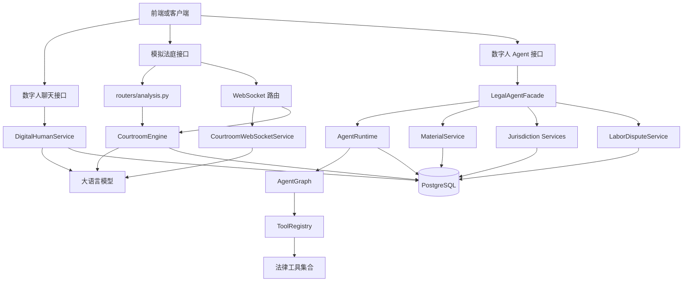
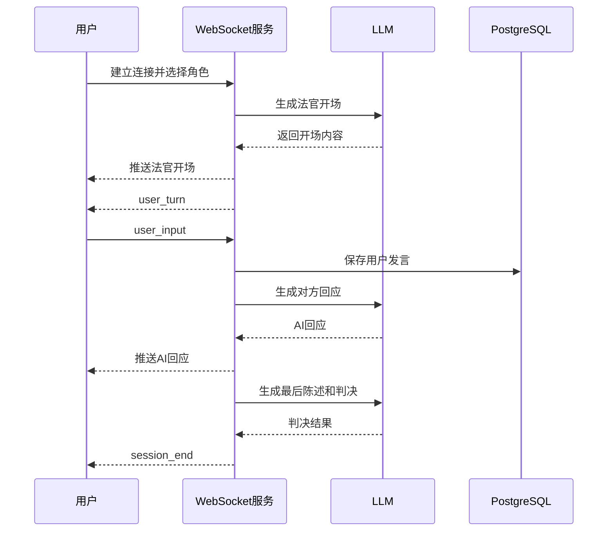
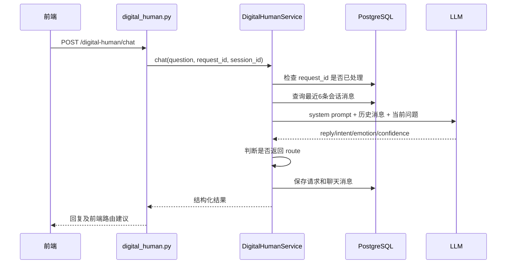
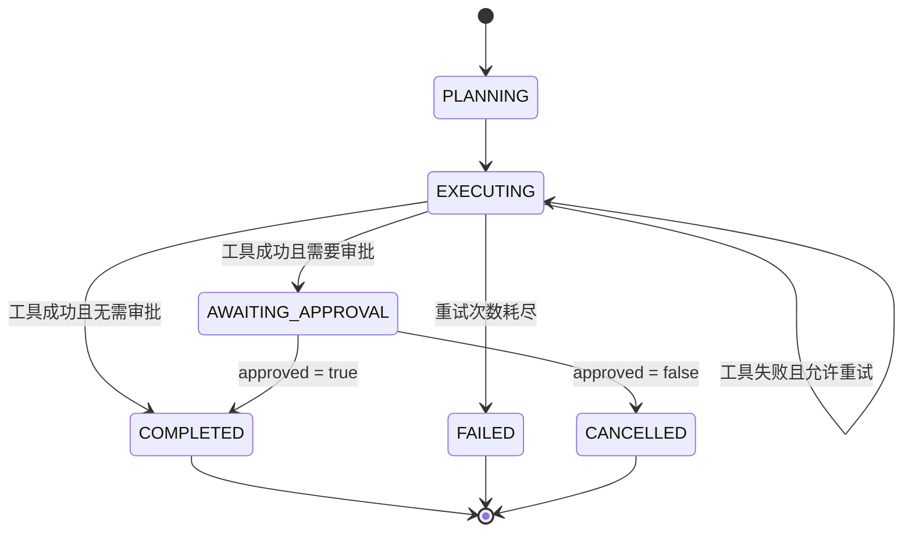
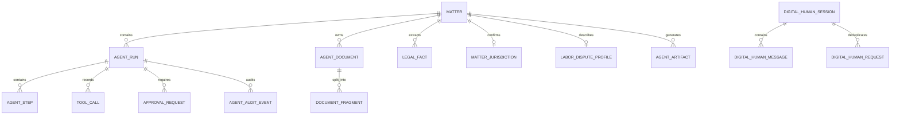
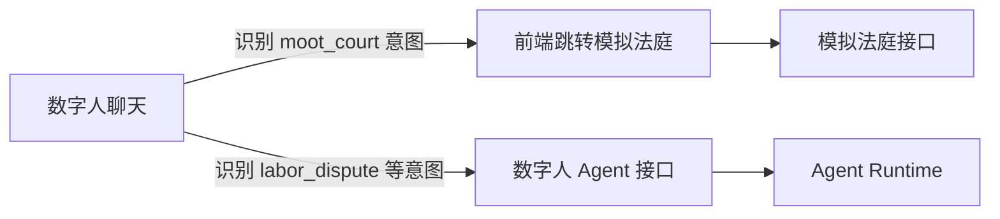
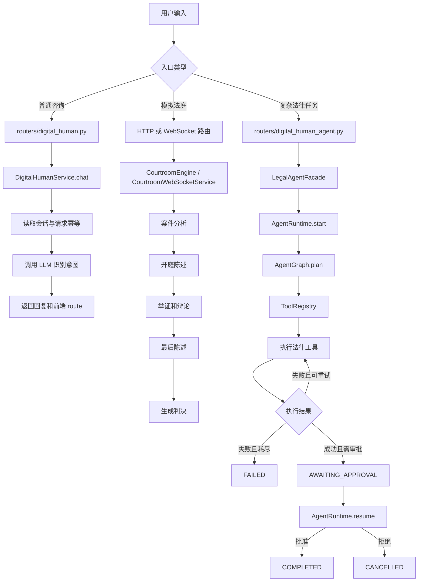

# 模拟法庭和当前数字人 Agent 详细分析

> 文档名称：`analyse-agents.md`  
> 目标位置：`D:\项目\law\raw\analyse-agents.md`  
> 分析范围：模拟法庭模块、数字人聊天模块、法律数字人 Agent Runtime、材料与法域服务、劳动纠纷闭环。  
> 说明：本文依据当前会话中对项目文件的分析结果整理，未修改任何项目代码。

---

## 1. 总体结论

项目中的“模拟法庭”和“数字人 Agent”是两套相互独立但可以协作的业务系统。

- **模拟法庭**负责按照庭审阶段组织案件分析、双方陈述、举证、辩论、最后陈述和判决生成。
- **数字人聊天**负责与用户多轮交流、识别用户意图，并把用户引导到合同审查、模拟法庭、纠纷处理等具体功能。
- **数字人 Agent**负责执行需要多个步骤、工具调用、失败重试、人工审批和持久化恢复的法律任务。
- **劳动纠纷模块**是在 Agent 基础之上实现的具体业务闭环，用于收集事实、校验法域和法律依据、分析纠纷并生成仲裁申请书草稿。

二者的主要区别如下：

| 对比项 | 模拟法庭 | 数字人 Agent |
|---|---|---|
| 核心目标 | 模拟完整庭审过程 | 执行可拆解、可恢复、可审批的法律任务 |
| 核心驱动方式 | 庭审阶段状态流转 | LangGraph 任务状态机 |
| 主要状态 | 开庭、举证、辩论、陈述、评议、判决 | 规划、执行、审批、完成、失败、取消 |
| LLM 作用 | 扮演原告、被告、法官生成庭审内容 | 规划任务或配合工具完成法律工作流 |
| 工具系统 | 主要直接调用 LLM 和数据库 | 通过 ToolRegistry 白名单统一调用工具 |
| 人工参与 | 用户可扮演原告或被告进行实时发言 | 对关键操作执行人工审批门控 |
| 数据持久化 | 庭审会话、证据、争议点、辩论回合 | Run、Step、ToolCall、Approval、Audit、Artifact 等 |

---

## 2. 项目整体架构



从调用层次看，项目可以分为五层：

1. **路由层**：接收 HTTP 或 WebSocket 请求。
2. **门面/服务层**：统一组织业务模块，屏蔽内部实现细节。
3. **状态机与业务编排层**：控制模拟庭审阶段或 Agent 任务阶段。
4. **工具与模型层**：调用 LLM、材料解析、法律来源验证、补偿计算等能力。
5. **持久化层**：保存会话、运行状态、步骤、审批、证据、法律事实和文书。

---

# 第一部分：模拟法庭系统

## 3. 模拟法庭的实现方式

模拟法庭本质上是一个由阶段状态驱动的法律内容生成系统。

庭审阶段如下：

```text
OPENING
  ↓
EVIDENCE
  ↓
ARGUMENT
  ↓
CLOSING
  ↓
DELIBERATION
  ↓
VERDICT
```

每进入一个阶段，系统都会根据当前案件、双方已有陈述、证据和争议焦点构造 Prompt，再让大语言模型以对应角色生成内容。

- 原告阶段：模型扮演原告或原告代理人。
- 被告阶段：模型扮演被告或被告代理人。
- 判决阶段：模型扮演法官。
- 用户参与模式：用户扮演一方，另一方由 AI 生成发言。

模拟法庭同时提供两种交互方式：

### 3.1 HTTP REST 模式

适合前端通过按钮或表单逐步推进庭审。

```text
前端
  ↓ HTTP
routers/analysis.py
  ↓
services/courtroom_engine.py
  ↓
DeepSeek LLM / PostgreSQL
```

特点：

- 每个庭审动作对应一个独立接口。
- 前端决定何时提交证据、生成辩论、进入最后陈述和生成判决。
- 实现简单，便于调试和查看每一步结果。

### 3.2 WebSocket 实时模式

适合数字人语音或文字实时交互。

```text
前端 WebSocket
  ↓
app.py 中的 Sock 路由
  ↓
services/courtroom_websocket_service.py
  ↓
LLM
```

项目中还存在一套异步 WebSocket 实现：

```text
前端 WebSocket
  ↓
routers/courtroom_websocket.py
  ↓
services/courtroom_engine.py
```

这说明项目当前可能同时保留了：

- 基于 Flask-Sock 的同步实现；
- 基于 async/await 风格的异步实现。

实际部署时应确认当前 `app.py` 注册并使用的是哪一套，避免两套实现长期并行导致维护重复。

---

## 4. 模拟法庭相关文件职责

### 4.1 `services/courtroom_engine.py`

这是模拟法庭的核心业务引擎，负责管理庭审会话、调用模型、保存庭审结果以及推进阶段。

全局通常通过以下方式获取：

```python
engine = get_courtroom_engine()
```

核心函数：

| 函数 | 职责 |
|---|---|
| `create_session(case_description, case_type)` | 创建庭审会话，启动案件分析，并将结果写入数据库 |
| `_analyze_case(case_description, case_type)` | 调用 LLM 分析案件，提取案件标题、原告主张、被告抗辩和争议焦点 |
| `submit_evidence(session_id, party, ...)` | 保存某一方提交的证据 |
| `generate_opening_statement(session_id, party)` | 生成指定一方的开庭陈述并保存为辩论回合 |
| `generate_argument(session_id, party, target_issue)` | 针对指定争议点生成辩论意见 |
| `generate_closing_statement(session_id, party)` | 生成指定一方的最后陈述 |
| `generate_verdict(session_id)` | 以法官视角生成判决主文、理由和法律依据，并结束会话 |
| `_invoke_llm(messages)` | 底层 LLM 调用封装，使用 `httpx` 流式请求并带重试机制 |
| `get_all_sessions()` | 从数据库读取历史庭审会话 |

### 4.2 `services/courtroom_websocket_service.py`

该文件负责 Flask-Sock 同步 WebSocket 模式下的实时庭审流程。

核心函数：

| 函数 | 职责 |
|---|---|
| `start_session(ws, session_id, user_role, case_description)` | 创建实时庭审并根据用户角色选择运行模式 |
| `_run_auto_mode(session_id)` | 全 AI 庭审，原告、被告和法官均由模型扮演 |
| `_run_user_as_plaintiff(session_id)` | 用户扮演原告，AI 扮演被告 |
| `_run_user_as_defendant(session_id)` | 用户扮演被告，AI 扮演原告 |
| `_run_debate_phase(session_id, user_role)` | 控制双方交替辩论，最多进行指定轮数 |
| `_run_closing_phase(session_id, user_role)` | 控制双方最后陈述 |
| `_run_verdict_phase(session_id)` | 生成判决并向前端发送会话结束消息 |
| `_generate_ai_response(...)` | 根据角色、阶段和上下文生成 AI 发言 |
| `_wait_for_user_input(session_id, party)` | 阻塞等待用户输入，超时后可由 AI 代替发言 |
| `handle_user_input(session_id, content)` | 接收前端消息并解除等待状态 |
| `_continue_after_user_input(...)` | 用户发言后判断下一位发言者或下一庭审阶段 |

实时模式的典型流程：



### 4.3 `routers/analysis.py`

该文件负责模拟法庭 HTTP REST 接口，将请求参数转换为 `CourtroomEngine` 方法调用。

| 路由 | 调用逻辑 |
|---|---|
| `POST /debate/start` | 创建会话并生成双方开庭陈述 |
| `POST /debate/<id>/submit_evidence` | 调用 `submit_evidence()` |
| `POST /debate/<id>/argument` | 调用 `generate_argument()` |
| `POST /debate/<id>/closing` | 调用 `generate_closing_statement()` |
| `POST /debate/<id>/verdict` | 调用 `generate_verdict()` |
| `GET /debate/<id>/status` | 查询庭审阶段和当前状态 |
| `GET /debate/<id>/details` | 查询庭审完整详情 |
| `GET /debate/history` | 查询历史会话 |
| `DELETE /debate/<id>` | 删除指定庭审会话 |

### 4.4 `routers/courtroom_websocket.py`

该文件是异步 WebSocket 路由实现，使用 `CourtroomConnectionManager` 管理连接，并调用 `CourtroomEngine` 生成内容。

| 函数 | 职责 |
|---|---|
| `handle_courtroom_websocket(...)` | WebSocket 主循环，接收并分发客户端消息 |
| `start_courtroom_session()` | 生成法官开场并启动第一轮发言 |
| `handle_party_turn()` | 判断当前轮次由用户还是 AI 发言 |
| `generate_ai_response()` | 调用引擎生成指定角色发言 |
| `proceed_to_next_turn()` | 控制原告、被告、辩论、陈述和判决之间的流转 |
| `handle_user_input()` | 处理用户发言 |
| `handle_skip_turn()` | 用户跳过当前回合，由 AI 代替发言 |
| `handle_restart()` | 重新启动庭审流程 |

### 4.5 `services/debate_agent.py`

这是较早期的简化版实现。

主要函数：

```python
start_debate()
```

它接收案件描述和双方论据，一次性调用 LLM 生成法官意见，不具备完整的庭审阶段控制、实时交互和会话恢复能力。

当前功能已经基本被 `CourtroomEngine` 覆盖，因此更适合作为兼容代码、演示代码或后续清理对象。

### 4.6 `models/db_models.py`

与模拟法庭有关的主要模型：

| 模型 | 用途 |
|---|---|
| `Case` | 保存案件基本信息 |
| `CourtSession` | 保存庭审会话和当前阶段 |
| `Evidence` | 保存原告或被告提交的证据 |
| `LegalIssue` | 保存案件争议焦点 |
| `DebateTurn` | 保存每一轮原告、被告或法官发言 |

---

## 5. 模拟法庭调用流程

### 5.1 HTTP 调用

#### 创建庭审

```http
POST /api/debate/start
Content-Type: application/json

{
  "case_description": "张三与李四之间发生合同纠纷……",
  "case_type": "民事纠纷"
}
```

内部调用：

```text
routers/analysis.py
  → engine.create_session()
  → engine.generate_opening_statement(PLAINTIFF)
  → engine.generate_opening_statement(DEFENDANT)
```

#### 提交证据

```http
POST /api/debate/{session_id}/submit_evidence
Content-Type: application/json

{
  "party": "plaintiff",
  "evidence_name": "合同原件",
  "evidence_content": "……",
  "evidence_type": "书证"
}
```

#### 生成辩论意见

```http
POST /api/debate/{session_id}/argument
Content-Type: application/json

{
  "party": "plaintiff"
}
```

#### 生成最后陈述

```http
POST /api/debate/{session_id}/closing
Content-Type: application/json

{
  "party": "plaintiff"
}
```

#### 生成判决

```http
POST /api/debate/{session_id}/verdict
```

### 5.2 WebSocket 调用

```javascript
const ws = new WebSocket(
  'ws://host/api/courtroom/ws/{session_id}?user_role=plaintiff&case_description=...'
)

ws.onmessage = (event) => {
  const message = JSON.parse(event.data)

  if (message.type === 'user_turn') {
    ws.send(JSON.stringify({
      type: 'user_input',
      content: '我方认为被告已经构成违约……'
    }))
  }
}
```

跳过当前轮次：

```javascript
ws.send(JSON.stringify({ type: 'skip_turn' }))
```

结束会话：

```javascript
ws.send(JSON.stringify({ type: 'end_session' }))
```

### 5.3 Python 内部调用

```python
from services.courtroom_engine import get_courtroom_engine, Party

engine = get_courtroom_engine()

session = engine.create_session(
    "张三与李四合同纠纷",
    "民事纠纷"
)

opening = engine.generate_opening_statement(
    session.id,
    Party.PLAINTIFF
)

argument = engine.generate_argument(
    session.id,
    Party.DEFENDANT
)

verdict = engine.generate_verdict(session.id)
```

---

# 第二部分：数字人聊天与 Agent 系统

## 6. 数字人 Agent 的整体分阶段设计

当前法律数字人系统采用渐进式架构，可划分为以下阶段：

| 阶段 | 功能 |
|---|---|
| Stage 0 | 数字人聊天、多轮会话、意图识别和前端功能路由 |
| Stage 1 | Agent Runtime：规划、执行工具、失败重试、人工审批、完成或取消 |
| Stage 2 | 案件工作区、材料上传、文本分片、事实提取、时间线和证据清单 |
| Stage 2.5 | Matter 恢复、请求去重、真实工具集成 |
| Stage 3 | 劳动纠纷事实收集、法律分析和仲裁申请书草稿生成 |

整体调用链：

```text
浏览器
  │
  ├─ routers/digital_human.py
  │    └─ services/digital_human_service.py
  │         ├─ LLM
  │         └─ PostgreSQL
  │
  └─ routers/digital_human_agent.py
       └─ legal_agent_system/facade.py
            ├─ runtime/
            ├─ matters/
            ├─ jurisdictions/
            ├─ labor_disputes/
            ├─ tools/
            └─ PostgreSQL
```

---

## 7. Stage 0：数字人聊天层

### 7.1 `routers/digital_human.py`

负责对外暴露数字人聊天相关 HTTP 接口，例如：

- `/digital-human/chat`
- `/digital-human/sessions`
- `/digital-human/reset`

路由层只负责：

1. 读取请求参数；
2. 校验客户端身份和必要字段；
3. 调用 `DigitalHumanService`；
4. 将结果转换为 HTTP 响应。

### 7.2 `services/digital_human_service.py`

这是聊天和意图识别的核心服务。

主要职责：

- 管理数字人会话；
- 读取最近的聊天历史；
- 构造系统 Prompt；
- 调用大语言模型；
- 解析结构化返回结果；
- 判断是否需要跳转到具体法律功能；
- 保存用户消息和数字人回复；
- 使用 `request_id` 防止重复请求。

典型执行流程：



模型预期返回的数据结构：

```json
{
  "reply": "……",
  "intent": "moot_court",
  "emotion": "neutral",
  "confidence": 0.91
}
```

当满足以下条件时，后端会向前端返回具体页面路由：

```text
confidence >= 0.6
且
intent != general_chat
```

可识别的业务通常包括：

- 普法问答；
- 合同审查；
- 模拟法庭；
- 纠纷中心；
- 法律文书起草；
- 法律计算器；
- 其他已配置的前端功能。

因此，Stage 0 更像一个“数字人统一入口和业务导航器”，而不是执行复杂任务的 Agent Runtime。

---

## 8. Stage 1：Agent Runtime 状态机

### 8.1 Runtime 的核心作用

`legal_agent_system/runtime` 是法律 Agent 的运行时引擎，负责驱动一个任务从创建到结束的完整生命周期。

核心流程：

```text
规划
  ↓
执行工具
  ↓
失败时重试
  ↓
等待人工审批
  ↓
完成或取消
```

更完整的状态机如下：



### 8.2 Runtime 相关文件

| 文件 | 职责 |
|---|---|
| `runtime/runtime.py` | `AgentRuntime` 入口协调器，负责启动和恢复任务 |
| `runtime/graph.py` | `AgentGraph`，使用 LangGraph 编排任务节点和条件路由 |
| `runtime/persistence.py` | `AgentRepository`，将运行状态、步骤、工具调用、审批和审计写入 PostgreSQL |
| `runtime/registry.py` | `ToolRegistry`，维护允许调用的工具白名单 |
| `runtime/schemas.py` | 定义 `AgentState`、`AgentTool`、`ToolResult` 等 Pydantic 数据模型 |
| `runtime/enums.py` | 定义运行状态、步骤状态和错误码 |
| `runtime/errors.py` | 定义 Agent 领域异常和错误码封装 |

---

## 9. Agent Runtime 各文件详细职责

### 9.1 `runtime/runtime.py`

`AgentRuntime` 是运行时入口，对外提供的核心操作通常包括：

```python
start(goal)
resume(run_id, approved)
```

主要职责：

1. 创建新的 AgentRun；
2. 构造初始 `AgentState`；
3. 调用 `AgentGraph` 执行状态图；
4. 将执行结果持久化；
5. 在用户审批后恢复暂停的任务；
6. 处理拒绝审批、取消、失败和终态。

### 9.2 `runtime/graph.py`

这是 Agent 的核心状态机。

主要节点：

```text
dispatch → plan → execute → finish
```

各节点作用：

| 节点 | 作用 |
|---|---|
| `dispatch` | 根据当前任务状态判断应该规划、执行、完成还是结束 |
| `plan` | 将用户目标转换为可执行步骤或工具调用计划 |
| `execute` | 从工具注册中心获取工具并执行，处理成功、失败和重试 |
| `finish` | 写入最终结果，将任务标记为完成 |

典型执行链：

```text
AgentRuntime.start(goal)
  ↓
Repository.create_run()
  ↓
AgentGraph.invoke(initial_state)
  ↓
dispatch
  ↓
plan
  ↓
execute
  ├─ 失败且未达到 max_retries → 再次 execute
  ├─ 失败且重试耗尽 → FAILED
  ├─ 成功且需要审批 → AWAITING_APPROVAL
  └─ 成功且无需审批 → finish → COMPLETED
```

### 9.3 `runtime/persistence.py`

该文件负责 Agent 全过程持久化，是任务可恢复和可审计的基础。

管理的数据通常包括：

- 运行记录 `AgentRun`；
- 执行步骤 `AgentStep`；
- 工具调用 `ToolCall`；
- 审批请求 `ApprovalRequest`；
- 审计事件 `AgentAuditEvent`；
- 当前 AgentState 快照。

关键作用：

- 每个节点执行后保存状态；
- 服务重启后从数据库恢复；
- 查询任务执行轨迹；
- 追踪工具输入、输出和异常；
- 记录谁在什么时间批准或拒绝了任务。

### 9.4 `runtime/registry.py`

`ToolRegistry` 是工具白名单。

Agent 不能直接通过名称任意执行 Python 函数，而必须先在注册中心登记。

典型逻辑：

```text
Agent 计划调用工具
  ↓
ToolRegistry 查询工具名称
  ├─ 已注册 → 返回 AgentTool 并执行
  └─ 未注册 → 抛出工具不存在或禁止调用异常
```

这一设计可以防止：

- 模型调用未授权函数；
- 模型直接访问内部敏感方法；
- 工具名称拼写错误后静默执行异常逻辑；
- 新增工具绕过审计和审批配置。

### 9.5 `runtime/schemas.py`

用于定义运行时统一数据契约。

主要模型：

| 模型 | 用途 |
|---|---|
| `AgentState` | 保存当前运行状态、目标、步骤、结果、错误和审批信息 |
| `AgentTool` | 描述工具名称、参数、处理函数、重试次数和是否需要审批 |
| `ToolResult` | 统一表示工具执行成功、失败、输出和错误信息 |

所有工具遵循统一调用形式：

```python
handler(call_id, arguments, attempt) -> ToolResult
```

### 9.6 `runtime/enums.py`

集中定义运行状态和错误码，避免代码中散落字符串。

可能包括：

```text
PLANNING
EXECUTING
AWAITING_APPROVAL
COMPLETED
FAILED
CANCELLED
```

### 9.7 `runtime/errors.py`

定义运行时领域异常，例如：

- 运行记录不存在；
- 工具未注册；
- 当前状态不允许恢复；
- 审批请求不存在；
- 工具执行失败；
- 参数不合法。

领域异常通常同时包含机器可识别的错误码，便于路由层返回稳定的 API 错误结构。

---

## 10. Agent 是如何实现和执行的

### 10.1 创建任务

前端发送：

```http
POST /digital-human/agent/runs
X-Digital-Human-Client-ID: dhc_xxx
Content-Type: application/json

{
  "goal": "帮我生成案件摘要",
  "session_id": "可选"
}
```

调用链：

```text
routers/digital_human_agent.py
  ↓
LegalAgentFacade.start_run()
  ↓
AgentRuntime.start()
  ↓
AgentRepository.create_run()
  ↓
AgentGraph
```

### 10.2 规划任务

`plan` 节点根据目标生成一个或多个可执行步骤。

在当前 Stage 1 演示中，规划可能直接选择：

```text
mock_case_summary
```

它主要用于验证以下机制是否可用：

- 工具注册；
- 工具调用；
- 首次失败；
- 自动重试；
- 成功后等待审批；
- 审批后完成任务。

因此，Stage 1 的 `mock_case_summary` 主要是运行时测试工具，并不等于完整的真实法律摘要能力。

### 10.3 执行工具

`execute` 节点执行过程：

```text
读取待执行步骤
  ↓
通过 ToolRegistry 获取工具
  ↓
创建 ToolCall 记录
  ↓
调用 handler(call_id, arguments, attempt)
  ↓
获得 ToolResult
  ↓
保存结果和审计事件
```

如果失败：

```text
attempt < max_retries
  → 增加 attempt
  → 重新执行
```

如果失败次数达到上限：

```text
RunStatus = FAILED
```

### 10.4 等待人工审批

当工具配置：

```text
requires_approval = true
```

工具成功后不会直接把任务标记为完成，而是：

1. 创建 `ApprovalRequest`；
2. 将运行状态改为 `AWAITING_APPROVAL`；
3. 暂停状态机；
4. 等待前端提交审批结果。

### 10.5 恢复任务

审批接口：

```http
POST /digital-human/agent/runs/{run_id}/resume
X-Digital-Human-Client-ID: dhc_xxx
Content-Type: application/json

{
  "approved": true
}
```

调用链：

```text
routers/digital_human_agent.py
  ↓
LegalAgentFacade.resume_run()
  ↓
AgentRuntime.resume()
  ↓
从数据库恢复 AgentState
  ↓
记录审批结果
  ↓
重新进入 AgentGraph
```

审批通过：

```text
finish → COMPLETED
```

审批拒绝：

```text
CANCELLED
```

### 10.6 查询和审计

```http
GET /digital-human/agent/runs/{run_id}
GET /digital-human/agent/runs/{run_id}/audit
```

查询接口用于获得当前任务快照；审计接口用于查看完整执行轨迹。

---

## 11. `facade.py` 门面层

`LegalAgentFacade` 是数字人 Agent 对外的统一入口。

路由层不需要知道 Runtime、材料、法域和劳动纠纷模块内部如何实现，只调用门面方法。

初始化关系大致如下：

```python
AgentRepository()
MaterialService()
LegalAuthorityService()
MatterJurisdictionService()
LaborDisputeService()
ToolRegistry()
AgentGraph(repository, registry)
AgentRuntime(repository, graph)
```

门面层的价值：

- 集中创建各服务和依赖；
- 统一注册 Agent 工具；
- 简化路由代码；
- 防止路由直接操作数据库或状态机；
- 为后续替换实现提供稳定入口。

Python 内部调用示例：

```python
from legal_agent_system import get_legal_agent_facade

facade = get_legal_agent_facade()

result = facade.start_run(
    "生成案件摘要",
    "dhc_客户端ID"
)

result = facade.resume_run(
    "run_xxx",
    "dhc_客户端ID",
    approved=True
)

snapshot = facade.get_run(
    "run_xxx",
    "dhc_客户端ID"
)
```

---

## 12. Stage 2：材料管理和法律法域

### 12.1 `matters/materials.py`

`MaterialService` 负责案件材料处理。

核心流程：

```text
create_matter()
  ↓
ingest_text()
  ↓
extract_facts()
  ↓
build_timeline()
  ↓
evidence_checklist()
```

主要功能：

| 函数 | 职责 |
|---|---|
| `create_matter()` | 创建案件工作区 |
| `ingest_text()` | 上传文本、按约 1000 字符分片、通过 SHA256 去重 |
| `extract_facts()` | 从文本中提取含日期、金额或法律关键词的候选事实 |
| `build_timeline()` | 从事实中提取日期并形成案件时间线 |
| `evidence_checklist()` | 汇总已有材料、事实和证据缺口 |

事实记录不仅保存内容，还会保存来源位置，例如：

- 文档 ID；
- 文档片段 ID；
- 字符起始偏移；
- 字符结束偏移。

这样可以追溯每一条事实来自哪一份材料的哪个位置。

### 12.2 `jurisdictions/registry.py`

`JurisdictionRegistry` 维护可用法域包。

当前分析结果显示，系统主要注册了中国法域：

```text
CN
```

### 12.3 `jurisdictions/service.py`

`MatterJurisdictionService` 负责案件法域确认。

重要设计：

> 法域必须由用户明确确认，不能完全由模型自动推定。

这是因为同一事实在不同地区、国家或法律体系下可能适用完全不同的法律规则。

### 12.4 `jurisdictions/authorities.py`

`LegalAuthorityService` 管理法律依据。

核心操作：

```text
register()
  ↓
verify()
```

登记信息通常包括：

- 标题；
- 法律全文；
- 来源 URL；
- 发布机构；
- 生效日期；
- 失效日期；
- 法律状态；
- 内容 SHA256。

验证内容：

1. 法域是否一致；
2. 状态是否为 `effective`；
3. 当前日期是否位于有效期内；
4. 内容哈希是否一致，防止来源被篡改。

---

## 13. Stage 3：劳动纠纷业务闭环

### 13.1 相关文件

| 文件 | 职责 |
|---|---|
| `labor_disputes/service.py` | 编排劳动纠纷事实收集、分析和草稿生成流程 |
| `labor_disputes/schemas.py` | 定义 `LaborDisputeFacts` 和字段追问题库 `FIELD_QUESTIONS` |

### 13.2 `update_facts()`

用户可以分多轮补充：

- 劳动者姓名；
- 用人单位；
- 入职日期；
- 离职或辞退日期；
- 工资；
- 合同情况；
- 欠薪金额；
- 加班情况；
- 争议发生时间。

每次更新后，系统会：

1. 合并新旧事实；
2. 校验字段格式；
3. 计算缺失字段；
4. 从 `FIELD_QUESTIONS` 选择下一轮问题；
5. 返回当前完成度。

### 13.3 `get_workflow()`

用于恢复工作流。

返回内容可能包括：

- 当前状态；
- 已填写事实；
- 缺失字段；
- 下一步计划；
- 是否满足分析条件；
- 是否已经生成草稿。

### 13.4 `analyze()`

在事实收集完成后执行法律分析。

前置检查：

```text
法域已确认且为 CN
  ↓
必要事实没有缺失
  ↓
相关法律来源已经登记
  ↓
法律来源验证通过
```

通过后执行：

- 计算可能的仲裁期限；
- 分析请求事项；
- 生成证据清单；
- 识别材料缺口；
- 输出下一步建议。

任一条件不满足时，系统不会继续生成文书，而是返回阻塞原因。

### 13.5 `create_draft()`

只有用户明确传入：

```json
{
  "approved": true
}
```

系统才会生成仲裁申请书草稿。

执行逻辑：

```text
再次调用 analyze()
  ↓
确认条件仍然满足
  ↓
根据事实和模板组装仲裁申请书
  ↓
保存为 AgentArtifact
  ↓
标记为草稿状态
```

草稿应明确标注：

- 不代表已经向仲裁机构提交；
- 需要用户或专业律师复核；
- 期限计算未必涵盖中止、中断等特殊情形。

---

## 14. Agent 工具注册中心

当前工具大致分为四类：

| 文件 | 工具 | 用途 |
|---|---|---|
| `tools/mock_case_summary.py` | `mock_case_summary` | 测试失败重试、成功和人工审批流程 |
| `tools/material_tools.py` | `parse_document` | 解析材料 |
| `tools/material_tools.py` | `extract_legal_facts` | 提取法律事实 |
| `tools/material_tools.py` | `build_case_timeline` | 构建案件时间线 |
| `tools/material_tools.py` | `generate_evidence_checklist` | 生成证据清单 |
| `tools/authority_tools.py` | `register_legal_authority` | 登记法律来源 |
| `tools/authority_tools.py` | `verify_legal_citation` | 验证法律引用 |
| `tools/labor_tools.py` | `calculate_labor_compensation` | 估算劳动经济补偿 |

所有工具使用统一形式：

```python
handler(call_id, arguments, attempt) -> ToolResult
```

这使 Runtime 可以用同一套方式处理：

- 工具参数；
- 执行结果；
- 异常；
- 重试次数；
- 是否需要审批；
- 审计日志。

---

## 15. 数据库模型关系



主要模型用途：

| 模型 | 用途 |
|---|---|
| `Matter` | 案件工作区，是材料、事实、法域和文书的聚合根 |
| `AgentRun` | 一次 Agent 任务运行 |
| `AgentStep` | 任务中的一个执行步骤 |
| `ToolCall` | 工具调用记录 |
| `ApprovalRequest` | 人工审批记录 |
| `AgentAuditEvent` | 全流程审计事件 |
| `AgentDocument` | 用户上传的案件材料 |
| `DocumentFragment` | 材料文本分片 |
| `LegalFact` | 从材料中提取的事实 |
| `MatterJurisdiction` | 用户确认的案件法域 |
| `LaborDisputeProfile` | 劳动纠纷事实和流程状态 |
| `AgentArtifact` | Agent 生成的仲裁申请书等文书 |
| `DigitalHumanSession` | 数字人聊天会话 |
| `DigitalHumanMessage` | 会话消息 |
| `DigitalHumanRequest` | 防重复请求记录 |
| `LegalAuthority` | 法律来源库 |

---

## 16. 数字人 Agent API 调用汇总

所有 Agent 请求通常需要携带：

```http
X-Digital-Human-Client-ID: dhc_xxx
```

### 16.1 数字人聊天

```http
POST /digital-human/chat

{
  "question": "我被公司辞退了怎么办？",
  "request_id": "dhr_xxx",
  "session_id": "dh_xxx"
}
```

### 16.2 Agent 任务

```http
POST /digital-human/agent/runs
GET  /digital-human/agent/runs/{run_id}
POST /digital-human/agent/runs/{run_id}/resume
POST /digital-human/agent/runs/{run_id}/cancel
GET  /digital-human/agent/runs/{run_id}/audit
```

### 16.3 材料和法域

```http
POST /digital-human/agent/matters
POST /digital-human/agent/matters/{matter_id}/materials
POST /digital-human/agent/matters/{matter_id}/materials/{document_id}/facts
GET  /digital-human/agent/matters/{matter_id}/timeline
POST /digital-human/agent/matters/{matter_id}/jurisdiction
POST /digital-human/agent/legal-authorities
POST /digital-human/agent/legal-authorities/{authority_id}/verify
```

### 16.4 劳动纠纷

```http
GET   /digital-human/agent/matters/{matter_id}/labor-dispute
PATCH /digital-human/agent/matters/{matter_id}/labor-dispute/facts
POST  /digital-human/agent/matters/{matter_id}/labor-dispute/analyze
POST  /digital-human/agent/matters/{matter_id}/labor-dispute/draft
POST  /digital-human/agent/matters/{matter_id}/tools/labor-compensation
```

---

# 第三部分：两套系统的关系与当前判断

## 17. 模拟法庭和数字人 Agent 的关系

目前二者主要通过“数字人入口”和前端路由产生联系，并没有证据表明模拟法庭已经完全接入 Agent Runtime。

实际关系更接近：



也就是说：

- 数字人聊天识别到“我要模拟庭审”，返回模拟法庭页面路由；
- 前端进入模拟法庭后，直接调用模拟法庭 HTTP 或 WebSocket 接口；
- 模拟法庭内部主要由 `CourtroomEngine` 驱动；
- Agent Runtime 当前更多用于案件材料、法域、劳动纠纷和文书任务。

如果未来希望统一，可以将模拟法庭中的关键动作封装为 Agent 工具，例如：

```text
create_court_session
analyze_court_case
generate_opening_statement
submit_court_evidence
generate_court_argument
generate_court_verdict
```

但在当前项目中，不应直接认定模拟法庭已经由 `AgentGraph` 编排。

---

## 18. 当前设计亮点

### 18.1 安全边界清晰

- 工具必须注册后才能调用；
- 法域必须由用户确认；
- 法律来源必须验证；
- 关键文书必须经过人工审批；
- 模型不能直接绕过状态机完成受控操作。

### 18.2 全流程可追溯

- Agent 每一步保存数据库；
- 工具调用记录参数、结果和错误；
- 事实可以追溯到材料片段和字符位置；
- 法律来源保存 URL、有效日期和 SHA256；
- 审批行为和运行状态具有审计记录。

### 18.3 支持暂停和恢复

AgentState 和执行记录持久化到 PostgreSQL 后，服务重启仍可恢复任务，而不是依赖单个 Python 进程的内存状态。

### 18.4 业务与运行时分离

- Runtime 只负责状态、工具、重试、审批和恢复；
- 劳动纠纷服务负责具体业务规则；
- 材料服务负责事实和证据；
- 法域服务负责法律适用范围；
- 门面层负责组装这些模块。

这种分层比把所有逻辑写在一个 Agent Prompt 中更稳定、可测试、可审计。

---

## 19. 当前需要注意的问题

以下判断来自现有分析结果，建议后续结合源码和实际注册路由再次核对。

### 19.1 模拟法庭存在两套 WebSocket 实现

当前同时看到：

- `services/courtroom_websocket_service.py`：Flask-Sock 同步模式；
- `routers/courtroom_websocket.py`：异步模式。

需要确认实际生产入口，否则可能出现：

- 功能重复；
- 消息格式不一致；
- 一套已废弃但仍被误调用；
- 状态保存逻辑不一致。

### 19.2 `debate_agent.py` 可能属于旧实现

`start_debate()` 已经被 `CourtroomEngine` 的完整流程覆盖。保留时应明确用途，避免新功能误接入旧接口。

### 19.3 Stage 1 的摘要工具仍是 Mock

`mock_case_summary` 主要验证 Runtime，不应在产品说明中描述为成熟的真实案件摘要能力。

### 19.4 Runtime 规划能力需要区分“真实 LLM 规划”和“固定规则规划”

当前分析确认了 `plan` 节点和 LangGraph 流程，但是否由 LLM 动态生成多步骤计划，需要结合 `runtime/graph.py` 实际代码进一步确认。

如果只是根据目标固定选择工具，则它属于“状态机式 Agent”；如果会由模型动态生成工具序列，才更接近完整的规划型 Agent。

### 19.5 法律期限计算不能只依赖固定 365 天

当前劳动争议模块采用“权利受侵害日期加 365 天”的基础口径，但实际法律场景可能涉及：

- 仲裁时效中断；
- 仲裁时效中止；
- 劳动关系存续期间拖欠工资；
- 特殊主体或特别程序。

系统已经通过免责声明控制风险，但后续业务完善时仍需扩展规则模型。

---

## 20. 最终调用关系总览



---

## 21. 一句话概括

### 模拟法庭

模拟法庭是以 `CourtroomEngine` 为核心、按照庭审阶段推进、通过 LLM 分别扮演原告、被告和法官，并支持 HTTP 分步调用与 WebSocket 实时交互的庭审模拟系统。

### 数字人 Agent

数字人 Agent 是以 `LegalAgentFacade` 为统一入口、以 LangGraph 状态机为执行核心、通过工具白名单完成具体任务，并使用 PostgreSQL 实现重试、审批、审计和恢复的可控法律任务系统。

### 两者当前关系

数字人聊天负责识别用户意图和引导页面；模拟法庭与 Agent Runtime 当前各自执行自己的业务流程，尚不能简单视为同一个 Agent 状态机。
